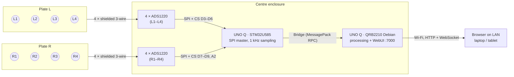

# open-fp — Project Initialization

Handoff document for bootstrapping a fresh git repository. Two low-profile golf force plates (one per foot) measuring vertical ground reaction force at 8 load cells, driven by a single Arduino UNO Q, with a LAN-accessible web dashboard for live weight shift and swing replay.

> **For the implementing agent:** read §0 first. Anything marked **VERIFY** is a detail about the UNO Q toolchain or a purchased part that could not be confirmed when this doc was written. Confirm it against the installed library/tool (headers, `--help`, datasheet) before relying on it, and record what you found in `docs/VERIFIED.md`.

---

## 0. Ground rules for the agent

1. Work milestone by milestone (§12). Each milestone ends with a commit and a passing check.
2. Hardware is already purchased and the print files already exist (§4). Do not change the mechanical design without asking the owner.
3. Keep the data path honest: vertical force only (see §1 limitations). Don't invent metrics the hardware cannot measure.
4. All signal processing lives in pure Python modules with unit tests that run on a dev machine with no hardware (§9, §11.5).
5. The web UI must work with the simulator (`tools/sim`) before it is ever pointed at real hardware.
6. Never hand-write App Lab metadata (`app.yaml`, `sketch.yaml`) from guesses; generate it once in App Lab and commit what it produces (§11.2).

---

## 1. System overview

| Item | Value |
|---|---|
| Plates | 2 × 304.8 × 304.8 × 6.35 mm 6061 aluminum, 4 load cells each |
| Standing height | ~22 mm floor to neoprene surface (on a shared rubber base, §6.8) |
| Sensors | 8 × 50 kg half-bridge load cells (400 kg total capacity) |
| ADC | 8 × ADS1220 (24-bit), one per corner, shared SPI bus |
| Controller | 1 × Arduino UNO Q: STM32U585 (Zephyr) samples, QRB2210 (Debian) processes and serves UI |
| Sampling | 1000 SPS per channel on the MCU → 5-sample mean → 200 Hz frames to Linux |
| Outputs | Per-foot vertical force, per-foot CoP, combined CoP, lead/trail %, swing capture, metrics |
| UI | Web app on `http://<board>.local:7000`, any device on the LAN |

### Limitations (state these in the README)

- **Vertical force only.** Four vertical cells per plate give Fz, and CoP (x, y) per plate. No shear forces, no torque about the vertical axis. Do not display "ground torque", "horizontal force", or "vertical torque" metrics.
- **Inter-channel skew ≤ ~1 ms.** ADCs run on their own oscillators; all 8 are read on the pacing DRDY of one board (§7.4).
- **Stream rate 200 Hz** because the MCU↔Linux router link defaults to 115200 baud (§8.4). Fine for weight shift; not for impact transients.
- Half-bridge cells + fixed resistors drift with temperature; the app auto-zeros (§9.4).

---

## 2. Repository layout

```
open-fp/
├── README.md                   # user-facing overview, photos, quickstart
├── LICENSE                     # match OpenFlight's license (ask owner)
├── .gitignore
├── .gitattributes              # LFS for CAD
├── docs/
│   ├── PROJECT_INIT.md         # this file
│   ├── assembly.md             # §6 expanded with photos as built
│   ├── wiring.md               # §7
│   ├── calibration.md          # §9.5
│   └── VERIFIED.md             # results of every VERIFY item
├── hardware/
│   ├── cad/
│   │   ├── stl/                # print files
│   │   ├── step/
│   │   └── src/                # CadQuery sources (forceplate_parts.py, extras_parts.py, assembly.py)
│   └── bom.md                  # §3
├── app/                        # the Arduino App Lab app (deployed to the board as a unit)
│   ├── app.yaml                # GENERATED by App Lab (§11.2)
│   ├── sketch/
│   │   ├── sketch.ino          # MCU firmware (§8)
│   │   ├── ads1220.h           # driver
│   │   └── sketch.yaml         # GENERATED by App Lab
│   ├── python/
│   │   ├── main.py             # entrypoint: Bridge + WebUI glue only
│   │   ├── requirements.txt    # VERIFY App Lab installs this
│   │   └── open_fp/        # pure-Python processing package (§9)
│   │       ├── __init__.py
│   │       ├── protocol.py     # binary frame decode
│   │       ├── config.py       # channel map, geometry, handedness
│   │       ├── calibration.py  # tare, gain fit, persistence
│   │       ├── pipeline.py     # counts → forces → CoP → lead/trail
│   │       ├── swing.py        # state machine, event detection, metrics
│   │       ├── store.py        # swing persistence
│   │       └── clock.py        # MCU µs → host time mapping
│   ├── assets/                 # static web UI, served by the WebUI brick (§10)
│   │   ├── index.html
│   │   ├── css/app.css
│   │   ├── js/{main,stance,chart,swings,calib,socket}.js
│   │   └── vendor/{uPlot.iife.min.js,uPlot.min.css,socket.io.min.js}
│   └── data/                   # runtime data (gitignored); VERIFY persistence (§9.7)
├── bench/
│   ├── ads1220_single/         # §7.7 bring-up sketch: 1 cell, raw counts to Monitor
│   └── ads1220_all/            # all 8 channels, noise stats
├── tools/
│   ├── deploy.sh               # rsync + arduino-app-cli start (§11.3)
│   ├── board_setup.sh          # one-time SSH key + checks
│   ├── sim/                    # desktop dev server with synthetic swings (§11.5)
│   │   ├── sim_server.py
│   │   └── synth.py
│   └── analysis/               # notebooks / scripts for offline swing analysis
└── tests/                      # pytest, no hardware
    ├── test_protocol.py
    ├── test_pipeline.py
    ├── test_calibration.py
    └── test_swing.py
```

### Init commands

```bash
git init open-fp && cd open-fp
git lfs install
cat > .gitattributes <<'EOF'
*.stl filter=lfs diff=lfs merge=lfs -text
*.step filter=lfs diff=lfs merge=lfs -text
EOF
cat > .gitignore <<'EOF'
__pycache__/
*.pyc
.venv/
.pytest_cache/
app/data/
tools/sim/.data/
.DS_Store
build/
EOF
mkdir -p docs hardware/cad/{stl,step,src} app/{sketch,python/open_fp,assets/{css,js,vendor},data} bench tools/{sim,analysis} tests
```

Then unzip `openflight_force_plate_prints.zip` (supplied by the owner alongside this doc): `*.stl` → `hardware/cad/stl/`, `*.step` → `hardware/cad/step/`, `*.py` → `hardware/cad/src/`, `README.txt` → `hardware/cad/`.

---

## 3. Bill of materials (already purchased)

| Qty | Part | Notes |
|---|---|---|
| 1 | Arduino UNO Q | 3.3 V logic on MCU header |
| 8 | 50 kg half-bridge load cell, 34 × 34 × 7.8 mm, 3-wire | two 4-packs; bundled HX711s unused |
| 8 | ADS1220 24-bit ADC breakout (generic module) | one per corner |
| 16 | 1 kΩ 0.1 % metal-film resistor | two per corner, completes each bridge |
| 2 | 12" × 12" × 1/4" 6061 aluminum plate | |
| 2 | 12" × 12" × 1/16" textured (fabric-finish) neoprene, 60A | top surface |
| 1 | 3M 468MP transfer tape, 12" wide | bonds neoprene to plate |
| 1 | Right-angle USB-C cable, 2 m | power + dev |
| 1 | Shielded 4-conductor 24 AWG cable, 5 m | cell leads |
| 1 | JST-XH 4-pin connector kit | cells swappable at the cradle end |
| — | 3/8" rubber gym flooring | must cover the **whole** footprint, ~500 × 900 mm (§6.8) |
| 16 | M4 × 12 flat-head (90° countersunk) + 16 M4 heat-set inserts | cradle → plate |
| 32 | M2 × 5 countersunk + 32 M2 heat-set inserts | retainers |
| ~30 | M2.5 × 6 + M2.5 heat-set inserts, 8 × M2.5 × 6 mm standoffs | Uno Q, ADCs, lid |
| — | PETG or ABS (~650 g), TPU 95A (~10 g) | |
| — | CA glue, heat-shrink, 22–24 AWG hookup wire, labels | |
| — | Calibration mass: 20 kg / 45 lb plate (known mass) + bathroom scale | |
| opt | 8 × 10 kΩ resistor | CS pull-ups (§7.3) |

---

## 4. Print files

All generated by CadQuery 2.8 (sources in `hardware/cad/src/`). Print on the Bambu H2D.

| File | Qty | Material | Settings | Orientation |
|---|---|---|---|---|
| `01_corner_cradle` | 8 | PETG/ABS | 5 walls, 40 % gyroid, ≥4 top layers | pocket side **up** (plate face on bed), see note below |
| `02_cradle_retainer` | 8 | PETG/ABS | 3 walls | flat |
| `03_centre_enclosure_base` | 1 | PETG/ABS | 3 walls, 20 % | open side up |
| `04_centre_enclosure_lid` | 1 | PETG/ABS | 3 walls, 20 % | vents up |
| `07_edge_ramp_left` | 6 | PETG/ABS | 3 walls, 20 % | flat bottom down |
| `07_edge_ramp_right` | 6 | PETG/ABS | 3 walls, 20 % | flat bottom down |
| `09_drill_template_a` | 1 | any | 100 % | lips up |
| `09_drill_template_b` | 1 | any | 100 % | lips up |
| `10_hub_foot_tpu` | 8 | TPU 95A | 100 % | flat, channel up (Ø18 locating foot, `hub_foot.py`) |
| `11_cell_shim_tpu_*` | 1 of each, then 8 | TPU 95A | 100 % | flat. Tuning set 1.5–3.5 mm (1–5 edge nicks); keep the thinnest that stops the cell rattling. Source `cad/src/cell_shim.py` |
| `08_assembly_two_plates.step` | — | reference only | | |

Key geometry (edit in `forceplate_parts.py` if your parts measure differently): cell pocket 34.6 × 34.6 × 8.2 mm; cradle 54 × 54 × 11.2 mm; heat-set holes M4 Ø5.6 × 6.5, M2.5 Ø3.5 × 5, M2 Ø3.2 × 4; enclosure 295 × 61 × 22 mm; ramps 60 mm run × 20 mm rise, 2 mm air gap to the plate.

**Cradle orientation (changed by owner, 2026-09-23):** print pocket side up, with the plate face on the bed. There are no supports or bridges, and the load-bearing pocket seat prints as a solid top surface rather than a 35 mm bridge. See `hardware/bom.md`.

**Before printing all eight cradles:** measure a load cell and print one cradle to check the fit.

---

## 5. Coordinate system and naming

Everything in software uses one **stance frame** (mm), viewed from above:

- Origin: midpoint between the two plate centres.
- **+x**: from Plate L toward Plate R.
- **+y**: toward the ball (toe side). The USB cable exits at −y (heel side, behind the golfer).
- Golfer stands on the plates facing +y. For a right-handed golfer, Plate L is under the left (lead) foot. `config.golfer = "RH" | "LH"` maps plates to lead/trail.

Corner channel IDs (also the physical labels on cables, cradles and ADC boards):

| Ch | ID | Plate | Corner | CS pin | Default position (x, y) mm |
|---|---|---|---|---|---|
| 0 | L1 | L | toe, outer | D3 | (−307.2, +122.4) |
| 1 | L2 | L | toe, inner | D4 | (−62.4, +122.4) |
| 2 | L3 | L | heel, inner | D5 | (−62.4, −122.4) |
| 3 | L4 | L | heel, outer | D6 | (−307.2, −122.4) |
| 4 | R1 | R | toe, inner | D7 | (+62.4, +122.4) |
| 5 | R2 | R | toe, outer | D8 | (+307.2, +122.4) |
| 6 | R3 | R | heel, outer | D9 | (+307.2, −122.4) |
| 7 | R4 | R | heel, inner | A2 (was D10, see §7.2) | (+62.4, −122.4) |

Defaults assume plate centres at x = ±184.8 mm (304.8 plate + 64.8 mm gap) and cells 30 mm in from each plate edge (±122.4 from plate centre). The enclosure floats, so the real gap varies: **measure plate centre spacing after setup and set `plate_spacing_mm` in config.** Positions are data, not code.

Put an arrow sticker on each plate pointing +y ("BALL →") and label plates L and R.

---

## 6. Mechanical assembly

### 6.1 Prep printed parts
1. Heat-set inserts: cradle top 2 × M4, cradle bottom 4 × M2; enclosure Uno Q bosses 4 × M2.5 and 6 lid posts × M2.5. ADC pad inserts are placed later (§6.7) once you know where the ADC boards' holes land.
2. Clean the cell pockets; the cell should drop in with light friction.

### 6.2 Drill the aluminum plates
Both plates are drilled identically (hole pattern is symmetric).

- Per corner: two Ø4.5 mm holes, 30 mm from edge E1, and 7.5 mm and 52.5 mm from edge E2.
- **E1 must be an edge parallel to the enclosure** (the plate's inner or outer edge). The holes then run parallel to the enclosure and the cradle's cable notch points toward it.
- Use the drill templates: lip E1 is the lip 30 mm from the guide holes. Template A fits two diagonally opposite corners; template B (mirror) fits the other two. Clamp, spot through the guides, remove template, drill.
- Countersink the top face (90°, ~8.2 mm) so M4 flat heads sit flush or just below. Deburr all edges; break the plate corners.

Hole coordinates with the plate's corner at origin and E1 along the y-axis: x ∈ {30, 274.8}, y ∈ {7.5, 52.5, 252.3, 297.3}.

### 6.3 Identify load cell wires
Each cell has 3 wires. Measure resistance between each pair: the pair reading ~2 kΩ is the two gauge ends (excitation); the remaining wire is the centre tap (signal). Typical colors are white/black = ends, red = centre, but trust the meter. Record per cell in `docs/wiring.md`.

### 6.4 Build each corner (×8)
1. Glue a TPU hub foot (`10_hub_foot_tpu`) centred on the cell's **raised centre boss** with CA. The foot is the only thing that touches the floor.
2. Seat the cell in the cradle pocket, boss/foot facing **down** (out the open bottom), wire exit aligned with the cradle's cable notch.
3. Screw the retainer on with 4 × M2 × 5. The foot protrudes through the 28 mm window; the retainer itself must clear the floor (~1.4 mm).
4. Terminate the cell wires in a JST-XH 4-pin plug (pin 1 E+, 2 E−, 3 S, 4 unused). Label L1…R4.

### 6.5 Mount corners to plates
Cradle centres are 30 mm in from both edges. Orient each cradle so its **cable notch faces the enclosure side** of the plate. M4 × 12 flat-heads from the top through the plate into the cradle inserts; blue threadlocker.

Check: set the plate on a flat floor. All four feet must touch; no rocking. If it rocks, shim under a cradle with tape, not under a foot.

### 6.6 Top surface
Apply 468MP transfer tape to the plate top, then the 1/16" textured neoprene. Roll it down; trim flush.

### 6.7 Enclosure
1. Mount the Uno Q on its 3 mm bosses (M2.5 × 6), USB-C toward the end-wall slot (−y, heel side).
2. Pad at +y end: ADCs for the toe corners L1, L2, R1, R2. Pad at −y end: L3, L4, R3, R4. Lay four boards out on each pad, mark hole positions on the 7.5 mm insert grid, install inserts there, mount on 6 mm standoffs.
3. If four boards don't fit per pad, mount them in two stacked pairs on longer standoffs; inner height is 17.5 mm.
4. Solder wires directly to the ADC boards (no pin headers) to stay under the lid.
5. Cable entry: toe cables through the +y slots, heel through the −y slots; outer corners use the slot 125 mm from centre, inner corners the one at 85 mm.

### 6.8 Floor setup
- Lay 3/8" rubber flooring under the **entire** setup: both plates, all ramps, and the enclosure. Ramps must sit on the same surface as the plates or they won't meet the plate edge height.
- Plates in place, enclosure in the gap with **≥2 mm clearance to each plate**. Ramps on the three outer sides of each plate, 2 mm gap.
- Rule: nothing touches a plate except the four feet and your shoes. A ramp or the box rubbing a plate edge will shunt load and corrupt readings.

---

## 7. Electrical

### 7.1 System diagram



### 7.2 UNO Q pin map

| Signal | UNO Q pin | Connects to |
|---|---|---|
| SCK | D13 | SCLK on all 8 ADS1220 |
| MOSI | D11 | DIN on all 8 |
| MISO | D12 | DOUT/DRDY on all 8 (tri-stated when CS high) |
| DRDY (pace) | D2 | **DRDY of L1 only** |
| CS L1–L4 | D3, D4, D5, D6 | CS of L1, L2, L3, L4 |
| CS R1–R4 | D7, D8, D9, **A2** | CS of R1, R2, R3, R4 |
| 3V3 | 3V3 | AVDD, DVDD, REFP0 on all 8; top of every bridge |
| GND | GND | AVSS/DGND, REFN0 on all 8; bottom of every bridge |

**Verified (2026-09-23, arduino:zephyr 1.0.0):** D11/D12/D13 = PB15/PB14/PB13 = SPI2 MOSI/MISO/SCK, the default `SPI`. D2 = PB3 and `attachInterrupt` is implemented. **D10 = PB9 is SPI2's hardware NSS in the board's pinctrl**, so `SPI.begin()` takes it over and drives it low during every transfer. R4's CS therefore moved to **A2 (PA6)**, and D10 must stay unconnected. A0 is avoided because the DAC claims it, and D0/D1 because they are the MCU console UART. See `docs/wiring.md`.

Other ADS1220 pins: tie CLK to DGND (internal oscillator) if the module exposes it and doesn't already. Leave the other boards' DRDY pins unconnected. **Do not tie DRDY pins together**: the ADS1220 DRDY output is push-pull and parallel outputs will fight. (An earlier sketch of this design showed a shared DRDY; that was wrong.)

Power budget on 3V3: each corner draws ~3.3 mA (cell 2 kΩ + resistor divider 2 kΩ), ~27 mA total plus ADCs. Fine for the UNO Q 3V3 rail. If the module has an onboard LDO expecting 5 V, **VERIFY** from its schematic before powering from 3V3.

### 7.3 Chip select safety
Set all CS pins OUTPUT HIGH as the very first lines of `setup()`, before `SPI.begin()` and before `Bridge.begin()`. Optional hardware belt-and-braces: 10 kΩ pull-up from each CS to 3V3 so boards stay deselected while the MCU boots.

### 7.4 Per-corner bridge (×8)

Each half-bridge cell is completed into a full Wheatstone bridge by two matched 1 kΩ resistors, measured differentially and ratiometrically (reference = the excitation), so supply drift cancels.

```
 3V3 ────────┬───────────────┬──────────────── REFP0
             │               │
        cell E+ (white)     R1 1kΩ 0.1%
             │               │
        cell S (red) ──AIN0  ├──AIN1
             │               │
        cell E− (black)     R2 1kΩ 0.1%
             │               │
 GND ────────┴───────────────┴──────────────── REFN0
             ADS1220 (one per corner)
```

- Solder R1/R2 directly across the ADC board's header pads (3V3→AIN1→GND), heat-shrinked, so each bridge is completed at its own ADC and both resistors share temperature.
- Cable: cell → JST-XH → shielded 4-core → ADC. Use 3 cores, leave the 4th spare. Connect the shield/drain to GND **at the ADC end only**.
- If a corner reads negative under load, either swap AIN0/AIN1 or set `sign: -1` for that channel in config. Prefer config.

### 7.5 Cable lengths
Inner corners ~250 mm, outer corners ~450 mm from JST to ADC. Run cables under the plate (14 mm clearance) and out the enclosure side. Label both ends.

### 7.6 Wiring checklist
- [ ] Continuity: each CS pin reaches only its board.
- [ ] No short 3V3–GND with all boards connected.
- [ ] Each AIN0/AIN1 pair sits near 1.65 V with no load (bridge balanced).
- [ ] Only L1 DRDY is wired, to D2.

### 7.7 Bench bring-up (before final assembly)
1. `bench/ads1220_single`: one cell on the bench, one ADS1220 on CS D3, DRDY on D2. Print raw counts via `Monitor.println` at ~10 Hz. Press the cell: counts should move by thousands, and return to baseline.
2. Record 10 s unloaded: report mean and standard deviation in counts. Put the numbers in `docs/VERIFIED.md`.
3. `bench/ads1220_all`: all 8 channels, verify register readback on every board, report per-channel noise and the achieved loop rate. Must sustain 1000 reads/s/channel with no missed DRDY.

---

## 8. MCU firmware (`app/sketch/`)

### 8.1 Responsibilities
- Configure 8 × ADS1220, verify register readback, report failures.
- Pace on L1 DRDY (1000 Hz); on each tick read all 8 channels via `RDATA`.
- Decimate 5:1 (boxcar mean) → 200 Hz frames.
- Batch 10 frames → one Bridge notification (20 Hz), with sequence number, timestamp, and flags.
- Provide control functions to Linux: status, reconfigure, restart.
- Optional: show state on the LED matrix ("ARM", "REC", a lead/trail bar).

### 8.2 ADS1220 configuration

| Reg | Value | Meaning |
|---|---|---|
| 0 | `0x0E` | MUX = AIN0/AIN1, gain 128, PGA enabled |
| 1 | `0xC4` | 1000 SPS **normal** mode, continuous conversion |
| 2 | `0x40` | External reference REFP0/REFN0, no 50/60 Hz filter, IDACs off |
| 3 | `0x00` | DRDY on dedicated pin only |

Commands: `RESET 0x06`, `START/SYNC 0x08`, `RDATA 0x10`, `WREG 0x43` (start reg 0, 4 regs), `RREG 0x23`. SPI mode 1, MSB first, 2 MHz. Wait ≥1 ms after RESET. Start conversions on L1 last so it paces reads of already-running boards.

Full scale at gain 128 with a 3.3 V reference is ±25.8 mV, comfortably above the bridge output at 50 kg. Check with the bench data that no channel saturates (±8388607) at 2× bodyweight on one corner.

### 8.3 Sketch skeleton

```cpp
// app/sketch/ads1220.h
#pragma once
#include <SPI.h>

namespace ads1220 {
constexpr uint8_t CMD_RESET = 0x06, CMD_START = 0x08, CMD_RDATA = 0x10;
constexpr uint8_t CMD_WREG_ALL = 0x43, CMD_RREG_ALL = 0x23;
constexpr uint8_t CFG[4] = {0x0E, 0xC4, 0x40, 0x00};
static const SPISettings SPI_CFG(2000000, MSBFIRST, SPI_MODE1);

inline void command(uint8_t cs, uint8_t c) {
  SPI.beginTransaction(SPI_CFG); digitalWrite(cs, LOW);
  SPI.transfer(c);
  digitalWrite(cs, HIGH); SPI.endTransaction();
}

inline bool configure(uint8_t cs) {
  command(cs, CMD_RESET); delay(1);
  SPI.beginTransaction(SPI_CFG); digitalWrite(cs, LOW);
  SPI.transfer(CMD_WREG_ALL);
  for (uint8_t v : CFG) SPI.transfer(v);
  digitalWrite(cs, HIGH); SPI.endTransaction();
  uint8_t rb[4];
  SPI.beginTransaction(SPI_CFG); digitalWrite(cs, LOW);
  SPI.transfer(CMD_RREG_ALL);
  for (auto &b : rb) b = SPI.transfer(0x00);
  digitalWrite(cs, HIGH); SPI.endTransaction();
  return memcmp(rb, CFG, 4) == 0;
}

inline int32_t read(uint8_t cs) {
  SPI.beginTransaction(SPI_CFG); digitalWrite(cs, LOW);
  SPI.transfer(CMD_RDATA);
  uint32_t v = (uint32_t)SPI.transfer(0) << 16;
  v |= (uint32_t)SPI.transfer(0) << 8;
  v |= SPI.transfer(0);
  digitalWrite(cs, HIGH); SPI.endTransaction();
  if (v & 0x800000) v |= 0xFF000000;   // sign-extend 24 → 32
  return (int32_t)v;
}
}  // namespace ads1220
```

```cpp
// app/sketch/sketch.ino
#include <Arduino_RouterBridge.h>
#include "ads1220.h"

constexpr uint8_t N_CH = 8;
constexpr uint8_t CS_PINS[N_CH] = {3, 4, 5, 6, 7, 8, 9, A2};   // L1..L4, R1..R4 (R4 on A2: D10 is SPI2 NSS)
constexpr uint8_t DRDY_PIN = 2;                                // L1 DRDY only
constexpr uint8_t DECIM = 5;                                   // 1000 Hz -> 200 Hz
constexpr uint8_t FRAMES_PER_MSG = 10;                         // 20 msgs/s
constexpr uint16_t MAGIC = 0xF01A;

volatile bool drdy = false;
volatile uint32_t drdyMissed = 0;
void onDrdy() { if (drdy) drdyMissed++; drdy = true; }

int64_t acc[N_CH];
uint8_t accN = 0;
int32_t frames[FRAMES_PER_MSG][N_CH];
uint8_t frameN = 0;
uint32_t seq = 0, tFirstUs = 0;
uint8_t flags = 0;
bool cfgOk[N_CH];

void startAll() {
  for (int i = N_CH - 1; i >= 0; --i) ads1220::command(CS_PINS[i], ads1220::CMD_START);  // L1 last
}

void sendBatch() {
  // Header (16 B, little-endian): magic u16, ver u8, n u8, seq u32, t_first_us u32,
  // period_us u16, flags u8, reserved u8. Then n * 8 * int32 LE.
  uint8_t buf[16 + FRAMES_PER_MSG * N_CH * 4];
  // ... pack header + frames into buf (memcpy; STM32 is little-endian) ...
  // VERIFY: which binary argument type Arduino_RouterBridge's notify() serializes as
  // MessagePack bin. If none, send a flat array of int32 instead (see §8.4 budget).
  // Bridge.notify("fp_frames", <bin or array>);
  seq++; flags = 0;
}

String fpStatus() {   // Linux calls this via Bridge.call("fp_status")
  String s = "{\"cfg\":[";
  for (int i = 0; i < N_CH; i++) { s += cfgOk[i] ? "1" : "0"; if (i < N_CH - 1) s += ","; }
  s += "],\"seq\":" + String(seq) + ",\"missed\":" + String(drdyMissed) + "}";
  return s;
}

void setup() {
  for (auto cs : CS_PINS) { pinMode(cs, OUTPUT); digitalWrite(cs, HIGH); }   // deselect first
  pinMode(DRDY_PIN, INPUT);
  SPI.begin();
  for (int i = 0; i < N_CH; i++) cfgOk[i] = ads1220::configure(CS_PINS[i]);
  Bridge.begin();
  Bridge.provide("fp_status", fpStatus);
  attachInterrupt(digitalPinToInterrupt(DRDY_PIN), onDrdy, FALLING);   // VERIFY on Zephyr core
  startAll();
}

void loop() {
  if (!drdy) return;
  drdy = false;
  uint32_t now = micros();
  for (int i = 0; i < N_CH; i++) {
    int32_t v = ads1220::read(CS_PINS[i]);
    if (v >= 8388000 || v <= -8388000) flags |= 0x02;   // near-saturation
    acc[i] += v;
  }
  if (++accN < DECIM) return;
  if (frameN == 0) tFirstUs = now;
  for (int i = 0; i < N_CH; i++) { frames[frameN][i] = (int32_t)(acc[i] / DECIM); acc[i] = 0; }
  accN = 0;
  if (drdyMissed) flags |= 0x01;
  if (++frameN == FRAMES_PER_MSG) { sendBatch(); frameN = 0; }
}
```

Notes:
- Never call Bridge functions from the ISR.
- If `Bridge.notify` blocks long enough to miss DRDY ticks, `drdyMissed` rises: move the send into a Zephyr work queue / double buffer, or reduce `FRAMES_PER_MSG` jitter by sending on a separate thread. **VERIFY** notify timing on hardware (milestone M2).
- The ADC reading loop costs ~8 × 20 µs ≈ 160 µs per 1 ms tick.

### 8.4 Link budget
The router link defaults to 115200 baud (~11.5 kB/s). **VERIFY** current default in `/etc/systemd/system/arduino-router.service` or equivalent.

| Option | Payload | Rate | Load |
|---|---|---|---|
| 200 Hz, int32, binary (default) | 16 + 320 B / msg | 20 msg/s | ~6.8 kB/s + RPC overhead (~60 %) |
| 200 Hz, int32 as MessagePack int array | ~420 B / msg | 20 msg/s | ~8.5 kB/s (~75 %), acceptable |
| 1000 Hz raw | ~24 kB/s | — | does not fit at 115200 |

If full 1 kHz is wanted later: (a) raise the router baud on both sides (**VERIFY** that the MCU side follows), or (b) keep a 1 kHz ring buffer on the MCU and let Linux fetch the last 4 s after a swing trigger via `Bridge.call("fp_dump", offset)` in chunks. (b) is the safer phase-2 feature.

---

## 9. Linux application (`app/python/`)

### 9.1 `main.py` (glue only)

```python
from queue import Queue, Empty
import time

from arduino.app_utils import App, Bridge
from arduino.app_bricks.web_ui import WebUI

from open_fp.config import load_config
from open_fp.protocol import decode_batch
from open_fp.pipeline import Pipeline
from open_fp.swing import SwingDetector
from open_fp.store import SwingStore

cfg = load_config("data/config.json")
pipe = Pipeline(cfg)                     # loads data/calibration.json if present
detector = SwingDetector(cfg)
store = SwingStore("data/swings")
ui = WebUI()                             # serves ../assets on :7000 (FastAPI + Socket.IO)
inbox: Queue = Queue(maxsize=200)

def on_frames(payload):                  # runs on the Bridge thread: do nothing heavy
    try:
        inbox.put_nowait(payload)
    except Exception:
        pipe.stats.dropped += 1

Bridge.provide("fp_frames", on_frames)

# REST API (see §9.8)
ui.expose_api("GET", "/api/status", lambda: pipe.status())
ui.expose_api("POST", "/api/zero", lambda: pipe.zero_now())
ui.expose_api("GET", "/api/swings", lambda: store.list())
ui.expose_api("GET", "/api/swings/{swing_id}", lambda swing_id: store.get(swing_id))
# ... calibration + config endpoints

_last_ui = 0.0
def loop():
    global _last_ui
    try:
        payload = inbox.get(timeout=0.05)
    except Empty:
        return
    batch = decode_batch(payload)                   # -> t (host s), counts (n, 8), flags
    samples = pipe.process(batch)                   # -> dict of arrays (see §9.3)
    for event in detector.update(samples):
        if event.kind == "swing_complete":
            store.save(event.swing)
            ui.send_message("swing", event.swing.summary())
    pipe.ui_buffer.extend(samples)
    now = time.monotonic()
    if now - _last_ui >= 1 / 30:                    # 30 Hz UI push, all samples since last push
        ui.send_message("live", pipe.ui_buffer.drain())
        _last_ui = now

App.run(user_loop=loop)
```

**VERIFY** in the installed `arduino.app_bricks.web_ui`: `send_message` event naming on the browser side, `expose_api` path-parameter support and request-body handling for POST, and that the server binds to all interfaces (reachable from another LAN machine).

### 9.2 `protocol.py`
- `decode_batch(payload) -> Batch(seq, t_first_us, period_us, flags, counts: ndarray[n, 8] int32)`.
- Header struct: `'<HBBIIHBB'` (16 bytes). Reject wrong magic/version; track sequence gaps.
- Accept both the binary form and the int-array fallback.

### 9.3 `pipeline.py`: counts → physics
Per channel *i*:

- Force (N): `F_i = sign_i · g_i · (c_i − z_i)` where `z_i` is the tare, `g_i` the gain (N/count).
- Per plate *p*: `Fz_p = Σ F_i`; `CoP_p = Σ F_i · pos_i / Fz_p` (only when `Fz_p` > 20 N, else NaN).
- Combined: `Fz = Fz_L + Fz_R`; `CoP = (Fz_L·CoP_L + Fz_R·CoP_R) / Fz`.
- Lead/trail: mapped from `config.golfer`; `lead_pct = 100 · Fz_lead / Fz`.
- Bodyweight `BW` (N): captured at quiet stance (§9.6) or entered manually; forces also reported as %BW.
- Optional light low-pass for display only (2nd-order Butterworth 20 Hz); raw 200 Hz kept for storage and metrics.

Sample record pushed to the UI (arrays, one entry per 200 Hz sample since last push):

```json
{
  "t": [..],                          // seconds, host clock
  "fz": {"L": [..], "R": [..]},       // N
  "cop": {"L": [[x,y],..], "R": [[x,y],..], "C": [[x,y],..]},  // mm, stance frame
  "lead_pct": [..],
  "bw_n": 812.4,
  "state": "armed",                   // idle | address | armed | swinging | review
  "flags": 0
}
```

### 9.4 Zeroing and drift
- Manual zero from UI (plates empty).
- Auto-zero: if total |F| < 20 N for 3 s, update tares slowly (EMA, τ ≈ 5 s).
- Warn in UI if any channel's tare moved > 2 % of its full scale since calibration.

### 9.5 Calibration (`calibration.py` + UI wizard)
1. Zero with plates empty (2 s average).
2. Per plate, place a known mass *m* (e.g. 20.0 kg plate) at five marked spots: centre, and over each cradle ~40 mm inboard. Hold each 3 s.
3. Solve per plate by least squares for the four gains: for placement *k*, `m · 9.80665 = Σ_i g_i · Δc_{i,k}`. Five equations, four unknowns; report residuals.
4. Validate: place the mass at the centre and at two off-centre marked spots; report force error (target < 1 %) and CoP error (target < 10 mm).
5. Bodyweight check: stand on both plates, compare to a bathroom scale (target within 1 %).
6. Save `data/calibration.json` with gains, tares, date, residuals. Keep previous files (`calibration-YYYYMMDD-HHMM.json`).

### 9.6 Swing detection (`swing.py`)
State machine, all thresholds in config and tuned on real data:

| State | Enter when |
|---|---|
| `idle` | total < 20 % BW |
| `address` | both feet > 10 % BW each, total within ±5 % BW, CoP speed < 20 mm/s |
| `armed` | `address` held ≥ 0.8 s → capture BW from this window |
| `swinging` | combined CoP lateral speed > 50 mm/s sustained 50 ms |
| trigger | lateral CoP toward lead > 300 mm/s (downswing shift), **or** an external shot event (§9.9), **or** manual |
| `review` | capture window closed: from 0.5 s before motion start to 1.5 s after trigger (max 6 s) |

Force events detected in each captured swing (labelled by what they are, not guessed swing positions):

- **Address**: mean lead % over the quiet window.
- **Motion start**: first sustained CoP movement.
- **Max trail**: minimum lead % (occurs near but not necessarily at the top of the backswing).
- **Transition**: lead % crosses 50 % after max trail.
- **Max lead**: maximum lead %.
- **Impact**: only from an external shot event or manual marking; otherwise shown as "not available".
- **Finish**: CoP settles (speed < 30 mm/s for 0.3 s).

Metrics per swing (all derivable from vertical force):

| Metric | Unit |
|---|---|
| Lead % at address, max trail, max lead, impact (if known) | % |
| Heel/toe CoP per foot at address and max lead | mm |
| Time max trail → transition (50/50) | ms |
| Time transition → max lead | ms |
| Peak rate of weight shift | %/s |
| Lateral CoP range and path length | mm |
| Peak CoP lateral speed and its time | mm/s, ms |
| Peak vertical force per foot and total | %BW |
| Peak lead vertical force time relative to impact (if known) | ms |

### 9.7 Storage (`store.py`)
- One swing = `data/swings/<id>.json` (metadata + metrics + events) and `<id>.npz` (200 Hz arrays: t, per-channel N, fz, cop, lead_pct).
- `GET /api/swings` returns summaries; `GET /api/swings/{id}` returns full arrays for replay; `GET /api/swings/{id}.csv` exports.
- **VERIFY** that `app/data/` persists across `arduino-app-cli app stop/start` and board reboots (apps run in containers). If not, use a host path that is mounted into the app container and document it.

### 9.8 HTTP API

| Method | Path | Purpose |
|---|---|---|
| GET | `/api/status` | link health, seq gaps, dropped msgs, per-channel cfg OK, saturation flags, state |
| POST | `/api/zero` | zero now |
| GET/PUT | `/api/config` | handedness, plate spacing, thresholds, BW override |
| POST | `/api/calib/start`, `/api/calib/capture`, `/api/calib/solve`, `/api/calib/save` | wizard steps |
| POST | `/api/record/arm`, `/api/record/trigger` | manual control |
| GET | `/api/swings`, `/api/swings/{id}`, `/api/swings/{id}.csv` | library + replay + export |
| DELETE | `/api/swings/{id}` | delete |
| POST | `/api/events/shot` | external impact event `{ "t_unix_ms": … }` (§9.9) |

Socket.IO messages from server: `live` (30 Hz), `swing` (new capture summary), `status` (1 Hz).

### 9.9 Clock and OpenFlight hook (`clock.py`)
- Map MCU `t_first_us` to host time: maintain a running linear fit of (MCU µs, host monotonic arrival) using the lower envelope of arrival times (arrivals are delayed, never early). Handle `micros()` wraparound.
- `POST /api/events/shot` with a Unix-ms timestamp from the OpenFlight launch monitor marks impact in the current or most recent swing. Both devices should be NTP-synced; expect ~5–20 ms error over Wi-Fi, which is fine for labelling but not for sub-10 ms metrics. Document this.

---

## 10. Web UI (`app/assets/`)

### 10.1 Design direction
Model the interaction patterns of mainstream golf pressure/force products (BodiTrak, Swing Catalyst, and similar): a dark, data-dense instrument panel with a top-down stance view and synced force traces. Take the patterns, not their branding, logos, or colors.

- Dark background (`#0B0F14`), panels `#121821`, 1 px `#1E2733` dividers.
- Fixed semantic colors: **lead = teal `#2EC4B6`**, **trail = orange `#FF9F1C`**, combined CoP = white, events = muted violet.
- Big tabular numerals for the headline numbers (`font-variant-numeric: tabular-nums`), system font stack.
- Works on a laptop and on an iPad in landscape beside the hitting bay; touch targets ≥ 44 px.
- No build step: static files, vanilla ES modules, vendored uPlot (charts) and Socket.IO client. Canvas 2D for the stance view.
- Handedness flips the rendering so lead is always drawn on the target side.

### 10.2 Layout (landscape)

```
┌──────────────────────────────────────────────────────────────────────────┐
│ ● Connected 200 Hz   BW 82.8 kg   [RH|LH]   [Zero]  ARMED ●      [⚙]      │
├──────────────────────────────┬───────────────────────────────────────────┤
│                              │  LEAD 62%              TRAIL 38%          │
│   STANCE VIEW                │  ███████████████████░░░░░░░░░░░           │
│   two plates (to scale)      ├───────────────────────────────────────────┤
│   foot outlines              │  FORCE TRACE (live: scrolling 5 s)        │
│   per-foot CoP dot, size∝F   │  lead %BW ─ teal  trail %BW ─ orange      │
│   combined CoP + trail (3 s) │  total %BW ─ white, event markers         │
│   colored by phase           │                                           │
├──────────────────────────────┴───────────────────────────────────────────┤
│ METRICS  addr 55/45 · max trail 71% · transition 180 ms · max lead 88% … │
├──────────────────────────────────────────────────────────────────────────┤
│ SWING LIBRARY  [card][card][card][card] →   (mini CoP trace + 3 numbers)  │
└──────────────────────────────────────────────────────────────────────────┘
```

### 10.3 Views and behavior
1. **Live**: stance view animates at display rate (interpolate 30 Hz packets); balance bar and big percentages; force trace scrolls. State badge shows idle / address / armed / swinging.
2. **Auto-capture**: when a swing completes, a toast shows headline metrics and the swing appears first in the library; UI stays live.
3. **Replay**: tap a swing card. Stance view shows the full CoP path colored by phase (address → max trail → transition → max lead → finish); a scrubber syncs the stance view and trace cursor; play at 0.25× / 0.5× / 1×; event markers are tappable to jump.
4. **Compare**: select two swings; overlay CoP paths (solid vs dashed) and traces aligned on transition (or impact if both have it); metrics table shows deltas.
5. **Calibrate**: step-by-step wizard for §9.5, with a live per-channel bar display and residuals shown at the end.
6. **Diagnostics**: per-channel raw counts, tare, noise (rolling std), saturation, link stats. Essential for bring-up.
7. **Settings**: handedness, plate spacing, BW override, thresholds, units (kg / lb / %BW).
8. Export: CSV per swing; PNG snapshot of stance view + trace for social posts.

### 10.4 Performance
- Keep one uPlot instance per chart, append with `setData` on a ring buffer; no chart re-creation per message.
- Stance view redraw with `requestAnimationFrame`; skip frames when the tab is hidden.
- Target end-to-end latency (plate → screen) < 150 ms.

---

## 11. Install and deploy on a fresh UNO Q

### 11.1 First boot (owner, once)
1. Install **Arduino App Lab** on the development computer.
2. Connect the UNO Q by USB-C. App Lab runs first-time setup: board name (use `open-fp`), Wi-Fi network, password for user `arduino`, and system/software updates. Accept all updates. **VERIFY** exact steps against the current App Lab release.
3. After setup, the board should be reachable on the LAN as `open-fp.local`. From the dev machine: `ssh arduino@open-fp.local`. If SSH isn't reachable, use `adb shell` over USB to enable it and check networking.

### 11.2 Create the app skeleton once in App Lab
1. In App Lab: create a new app named `open-fp`, add the **WebUI - HTML** brick.
2. Copy the generated `app.yaml` and `sketch/sketch.yaml` from the board (`~/ArduinoApps/open-fp/`, **VERIFY** path) into `app/` in the repo and commit. From then on the repo is the source of truth.
3. Check whether `python/requirements.txt` is honored for extra packages (numpy). **VERIFY**; if not, fall back to pure Python (200 Hz × 8 channels is light) or use a package already in the image.

### 11.3 `tools/board_setup.sh`

```bash
#!/usr/bin/env bash
# One-time: install SSH key, sanity-check the board.
set -euo pipefail
HOST="${1:-open-fp.local}"
ssh-copy-id "arduino@${HOST}"
ssh "arduino@${HOST}" '
  set -e
  uname -a
  which arduino-app-cli && arduino-app-cli --help | head -20
  systemctl status arduino-router --no-pager | head -5 || true
  mkdir -p ~/ArduinoApps
'
```

### 11.4 `tools/deploy.sh`

```bash
#!/usr/bin/env bash
# Sync the app to the board and (re)start it. First start compiles + flashes the MCU sketch
# and pulls brick containers, so the board needs internet access on the first run.
set -euo pipefail
HOST="${1:-open-fp.local}"
APP=open-fp
REMOTE="/home/arduino/ArduinoApps/${APP}"      # VERIFY path App Lab uses
rsync -az --delete --exclude 'data/' app/ "arduino@${HOST}:${REMOTE}/"
ssh "arduino@${HOST}" "
  arduino-app-cli app stop ${REMOTE} 2>/dev/null || true
  arduino-app-cli app start ${REMOTE}
"
echo "UI: http://${HOST}:7000"
```

**VERIFY** `arduino-app-cli` subcommands (`app start/stop`, logs) with `--help` and adjust. Add a `tools/logs.sh` once the log command is known.

Autostart on boot: App Lab can set an app to launch at startup. **VERIFY** the option (GUI and CLI) and document it in the README.

Standalone MCU flashing for bench sketches (no Linux side):
```bash
arduino-cli compile --fqbn arduino:zephyr:unoq bench/ads1220_single
arduino-cli upload  --fqbn arduino:zephyr:unoq -p <port> bench/ads1220_single
```

### 11.5 Development without hardware
`tools/sim/sim_server.py`: a small FastAPI + python-socketio server that

- serves `app/assets/` on `:7000`,
- implements the same REST routes and Socket.IO messages as the board,
- imports `app/python/open_fp` directly, feeding `synth.py` output through the real `Pipeline` and `SwingDetector`.

`synth.py` generates realistic 8-channel counts: quiet address (55/45), backswing shift to ~70 % trail, transition, rapid shift to ~85–90 % lead with a vertical force peak ~1.4 BW on the lead foot, finish; plus noise, a slow drift, and random swing tempo. This is also the fixture generator for `tests/`.

```bash
python -m venv .venv && . .venv/bin/activate
pip install fastapi uvicorn python-socketio numpy pytest
python tools/sim/sim_server.py   # open http://localhost:7000
pytest
```

---

## 12. Milestones and acceptance checks

| # | Milestone | Done when |
|---|---|---|
| M0 | Repo scaffold, CAD imported, README, BOM, this doc | Commit; `hardware/cad` populated |
| M1 | Bench: 1 cell + 1 ADS1220 | Register readback OK; noise numbers recorded; load changes counts correctly |
| M2 | All 8 ADCs on the bus, firmware batching | 1 kHz per channel sustained 10 min, `drdyMissed == 0`; noise per channel recorded |
| M3 | Bridge link + `protocol.py` | 200 Hz frames arrive on Linux, no sequence gaps over 10 min; link load measured |
| M4 | Pipeline + calibration | Total mass within 1 %; CoP within 10 mm at marked spots; bodyweight within 1 % of scale |
| M5 | UI live view (sim first, then hardware) | Reachable from another LAN device; latency < 150 ms; lead/trail sums to 100 % |
| M6 | Swing capture, replay, compare, metrics | 20 real swings captured, none missed, no false triggers while standing still for 2 min |
| M7 | Export + OpenFlight shot hook + LED matrix status | CSV/PNG export; shot event labels impact |
| M8 | Assembly docs with photos, autostart, README polish | Fresh-board deploy works from README alone |

Unit tests (no hardware): protocol round-trip and gap detection; CoP of a synthetic point load at every corner and centre; least-squares calibration recovers known gains from noisy synthetic data; swing detector finds the right events on synthetic swings and does not trigger on sway/shuffle fixtures.

---

## 13. Open questions and VERIFY list

1. Arduino_RouterBridge: binary argument support in `notify()`; blocking behavior; max message size.
2. Router baud rate default and whether it can be raised safely on both sides.
3. Zephyr core: `attachInterrupt` on D2, SPI on D11–D13 at 2 MHz, `micros()` resolution.
4. WebUI brick: Socket.IO event naming, `expose_api` path params and POST bodies, bind address, static asset path.
5. App container: persistent data path; `requirements.txt` support; whether numpy is preinstalled.
6. `arduino-app-cli` commands for start/stop/logs/autostart; App Lab app directory on the board.
7. ADS1220 module: exposed pins (CLK, REFP0/REFN0, AVDD/DVDD), onboard regulator, hole spacing.
8. Load cell wire colors (measure every cell, §6.3).

Record every answer in `docs/VERIFIED.md` with the tool/library version it was checked against.
