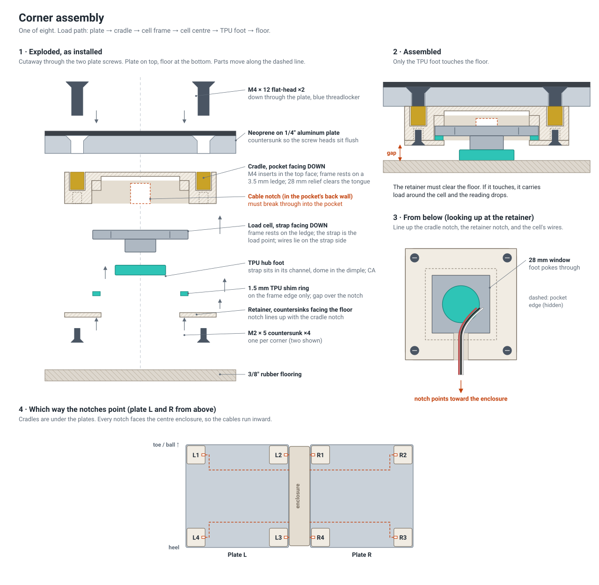

# Assembly

The full procedure is in [`PROJECT_INIT.md` §6](PROJECT_INIT.md#6-mechanical-assembly). Expand this page with photos and notes as the build goes (M8).

1. Prep printed parts: heat-set inserts, clean the cell pockets (§6.1)
2. Drill and countersink the aluminum plates using the drill templates (§6.2)
3. Identify the load cell wires and record them in [`wiring.md`](wiring.md) (§6.3)
4. Build each corner ×8: hub foot, cell, retainer, JST plug (§6.4). See [Corner assembly](#corner-assembly) below
5. Mount the corners to the plates, then check that no plate rocks (§6.5)
6. Apply the top surface: 468MP tape, then neoprene (§6.6)
7. Build the enclosure: Uno Q, ADC pads, cable entry (§6.7)
8. Floor setup: rubber base under everything, 2 mm clearances (§6.8)

**Rule:** nothing may touch a plate except its four feet and your shoes.

## Corner assembly

The drawing is generated by `docs/img/make_corner_diagram.py` from dimensions measured off the STL files.

For each of the 8 corners:

1. **Heat-set the inserts** in the cradle: 2 × M4 in the plate face and 4 × M2 in the pocket face. Scrape any ridge around the M4 holes flush, or the cradle will rock against the plate.
2. **Glue the TPU foot** centred on the load cell's raised centre boss, using CA.
3. **Seat the cell** in the pocket, boss and foot facing out of the pocket. Lay the wires flat on the cell's face and route them out through the **cable notch**.
4. **Screw on the retainer** with 4 × M2 × 5 countersunk screws, countersinks facing away from the cradle. Line its notch up with the cradle's notch so the wires aren't pinched. The foot must stick out through the 28 mm window, and the retainer must not touch a flat surface when the corner is set down.
5. **Put the JST-XH plug on** and label the corner (L1…R4). See [wiring.md §3](wiring.md#3-put-jst-xh-plugs-on-the-cells).
6. **Mount it on the plate** with 2 × M4 × 12 flat-heads from the top and blue threadlocker, **notch facing the enclosure** (panel 4 of the drawing).

> **Notch fix (2026-09-23).** The first cradle and retainer files had the cable notch stopping short: a 0.7 mm wall between the cradle's notch and pocket, and 4 mm of solid retainer between its notch and window. That wall trapped the wires, and the retainer would have clamped them against the cell. `01_corner_cradle` and `02_cradle_retainer` (STL and STEP) now have both notches cut through. Nothing else changed: exactly 35.3 mm³ and 44.8 mm³ were removed. If you printed the old version, trim the wall with a flush cutter and cut the retainer notch through to the window.
