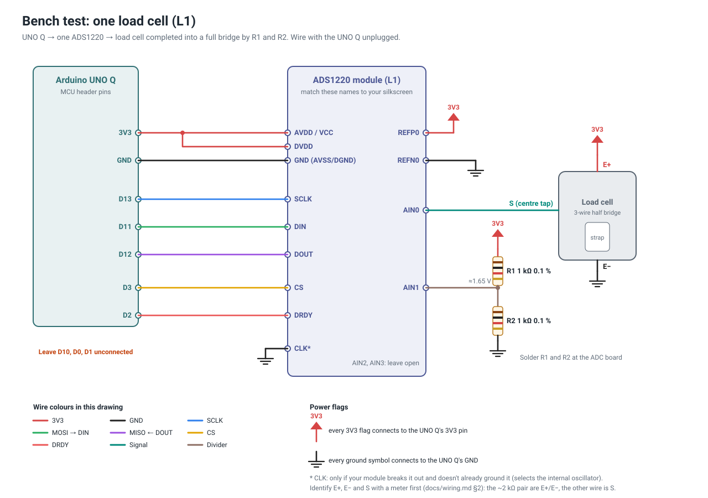

# Bench test: one load cell (milestone M1)

This test proves one load cell, one ADS1220 and the UNO Q work together before you wire all eight. It uses corner **L1**: chip select on **D3**, DRDY on **D2**. Budget about an hour. Most of it is soldering the ADC board.

You'll finish with numbers for [`VERIFIED.md`](VERIFIED.md): the register readback, the unloaded reading and its noise, the sample rate, and counts per kg if you have a known mass.

## What you need

- UNO Q, USB-C data cable, the dev machine with `tools/dev_setup.sh` already run
- 1 × ADS1220 module, 1 × load cell (in its cradle if you have one printed), 2 × 1 kΩ 0.1 % resistors
- Male-to-female jumper wires for the UNO Q header, 22–24 AWG hookup wire, soldering iron, multimeter
- Optional: a known mass for the scale check. A 2–5 kg dumbbell or a bag of flour works; the weight printed on it is close enough for this test.

## Wiring



Pin names below are as printed on the purple ADS1220 breakout used in this build. Its left edge, top to bottom, is DRDY, MISO, MOSI, SCLK, CS, CLK, DVDD, DGND. Its right edge is AIN0, AIN1, AIN2, AIN3, REFN0, REFP0, AVDD, AGND.

| From | To (breakout pin) | Notes |
|---|---|---|
| UNO Q **D2** | DRDY | |
| UNO Q **D12** | MISO | data from the ADC |
| UNO Q **D11** | MOSI | data to the ADC |
| UNO Q **D13** | SCLK | |
| UNO Q **D3** | CS | L1's chip select |
| GND | CLK | selects the internal oscillator |
| UNO Q **3V3** | DVDD **and** AVDD | **3V3, not 5V.** Both supply pins. |
| UNO Q **GND** | DGND **and** AGND | Both ground pins. |
| 3V3 | REFP0 | |
| GND | REFN0 | |
| 3V3 → **R1** → AIN1 → **R2** → GND | | completes the bridge; solder at the breakout |
| cell **E+** | 3V3 | |
| cell **E−** | GND | |
| cell **S** (centre tap) | **AIN0** | |
| — | AIN2, AIN3 | leave open |

Leave **D10, D0 and D1** unconnected: D10 is the SPI hardware chip select and D0/D1 are the MCU console. See [`wiring.md`](wiring.md#pin-map-reference).

## Steps

### 1. Identify the cell's wires

With a multimeter on resistance, measure all three pairs. The pair that reads **about 2 kΩ** is E+ and E−. The third wire is **S**. On this build's red/black/white cells, **red is S**, not white. Call either end E+; if you guess wrong, the reading falls instead of rising under load, which is fine for this test. Note the colours in the table in [`wiring.md` §2](wiring.md#2-identify-and-label-each-load-cell).

### 2. Prepare the ADS1220 module

1. Match the silkscreen to the table above. On this breakout the supply and ground are split: DVDD/DGND on the left edge, AVDD/AGND on the right. Wire both pairs.
2. **Check for a voltage regulator.** If the module has one designed for 5 V input, stop and ask before powering it from 3V3.
3. Check with continuity whether REFP0/REFN0 are already tied to AVDD/AGND on the board. If not, wire them as in the table.
4. Solder **R1** from AVDD (3V3) to AIN1 and **R2** from AIN1 to AGND, keeping the leads short.

### 3. Connect everything, with the UNO Q unplugged

Wire the table above. The UNO Q's MCU header has the same layout as an UNO R3: **3V3 and GND** are on the power header, and **D2–D13** are on the digital header.

### 4. Check before power

With the UNO Q still unplugged:

- [ ] **3V3 to GND** reads about **1 kΩ**. That's the cell's 2 kΩ in parallel with R1+R2's 2 kΩ. Near 0 Ω is a short: find it before continuing.
- [ ] D3 reaches only CS, and D2 reaches only DRDY.
- [ ] Nothing is connected to D10, D0 or D1.

### 5. Power up and measure

Plug the UNO Q in. With the meter on DC volts:

- **AIN0 to GND** and **AIN1 to GND**: both about **1.65 V**.
- **AIN0 to AIN1**: within about **10 mV** of each other. More than ~20 mV means the bridge is unbalanced enough to use up the ADC's ±25.8 mV input range. Recheck the S, R1 and R2 connections.

### 6. Flash the bench sketch

The UNO Q must be connected to the dev machine by USB:

```bash
tools/bench/flash.sh
```

This compiles and uploads [`bench/ads1220_single`](../bench/ads1220_single/ads1220_single.ino), replacing the MCU sketch of the deployed app. Run `tools/deploy.sh` afterwards to restore the app.

### 7. Look at the raw output (optional)

```bash
ssh -t arduino@open-fp.local arduino-app-cli monitor
```

Expect a readback line, then 10 lines per second:

```
R,1,0E,C4,40,00                     readback OK: registers match what was written
S,51234,100,1203456,420,1201800,1205100
  │     │   │       │   └ min/max over this 100 ms window
  │     │   │       └ noise: std of the 100 samples, in counts
  │     │   └ mean reading, in counts
  │     └ samples in the window (100 = 1000 SPS)
  └ MCU time, ms
```

The 8th field of each `S` line is the number of conversions the ADC signalled, counted by the DRDY interrupt. `n` can be lower, because each `Monitor` call blocks the MCU for about 13 ms.

Keys (type one, then Enter):

| Key | What it does |
|---|---|
| `v` | **Voltage check.** The ADC measures AVDD, AIN0 and AIN1 against its internal 2.048 V reference, and the external reference on REFP0/REFN0. Prints `V,<name>,<mV>`. Expect AVDD ≈ 3300, REF ≈ 3300, AIN0 and AIN1 ≈ 1650. |
| `s` | **Single-ended mode:** AIN0 against ground, gain 1. Works **before R1/R2 are fitted**. It tests wiring and response, not accuracy. |
| `d` | **Differential mode:** AIN0 − AIN1, gain 128. The real configuration; needs R1/R2. |
| `r` | Reset the ADC and re-check its registers. |

Ctrl-C exits.

### 8. Run the guided test

```bash
.venv/bin/python tools/bench/single_cell.py                 # readback, baseline, press test
.venv/bin/python tools/bench/single_cell.py --mass-kg 2.0   # plus counts per kg
.venv/bin/python tools/bench/single_cell.py --single-ended  # before R1/R2 are fitted
```

`--single-ended` uses thresholds for gain 1: a thumb press moves the reading by hundreds of counts rather than hundreds of thousands, and a known mass gives about 85–170 counts per kg.

It walks you through each step:

1. **Readback:** it asks the sketch to reset the ADC and checks the registers read back `0E C4 40 00`.
2. **Baseline:** 10 s with nothing on the cell. It checks the sample rate, noise, drift, and distance from full scale.
3. **Press test:** press the strap with your thumb and let go. The reading must move clearly and come back.
4. **Known mass** (optional): measures counts per kg.

Support the cell by its **outer frame** for steps 3 and 4. The cradle is ideal: set it pocket-up on the table with the cell in it, so the strap is free. The script prints PASS/FAIL for each step and saves a JSON copy to `bench/results/`.

## What good looks like

| Check | Expected | Worry if |
|---|---|---|
| Readback | `R,1,0E,C4,40,00` | `R,0,FF…` or `R,0,00…`: SPI or power wiring |
| Sample rate | ~1000 Hz (`n` = 100 per line) | much lower: DRDY isn't reaching D2 |
| Unloaded reading | anywhere within about ±7,500,000 | within 10 % of ±8,388,607: bridge unbalanced |
| Noise (std per sample) | a few hundred counts | thousands or more: a loose or long unshielded wire |
| Thumb press | moves by tens to hundreds of thousands | barely moves: S not on AIN0, or pressing the frame instead of the strap |
| Counts per kg | roughly 5,000–30,000 | outside 3,000–60,000: wiring or the wrong pair as E+/E− |

The counts-per-kg range assumes a 50 kg cell at about 0.5–1 mV/V. Your number is the real sensitivity, which calibration will measure properly later.

## Troubleshooting

| Symptom | Likely cause |
|---|---|
| No output at all in step 7/8 | Sketch not flashed, or the board isn't on the network (`ping open-fp.local`) |
| `E,no DRDY for 500 ms` | DRDY not on D2; ADC unpowered; readback failed |
| Readback `FF FF FF FF` | MISO not on D12, CS not on D3, or ADC unpowered (check both DVDD and AVDD) |
| Readback `00 00 00 00` | MISO isn't reaching D12 (an unconnected D12 floats low and reads 00), MOSI or SCLK not connected, or MISO shorted to GND |
| Reading pinned at ±8,388,607 | Run the voltage check (`v`). AIN0 or AIN1 floating; R1/R2 missing; S not connected |
| `V,AIN0,>2048` (AIN0 at the 3.3 V rail) | The wire on AIN0 is E+, not S (re-identify the wires: S is the one **not** in the 2 kΩ pair), or E− isn't connected to GND, so S floats up to E+ |
| `V,REF,<AVDD/4…` | REFP0/REFN0 aren't connected to 3V3/GND |
| Reading moves when you touch a wire | Noise pickup: shorten wires, twist the cell's three wires together |
| Reading drifts steadily | Warm-up (give it 5 min), or the cell is touching something |

## When you're done

1. Copy the numbers into the Bench measurements table in [`VERIFIED.md`](VERIFIED.md), for channel L1.
2. Run `tools/deploy.sh` to put the app's MCU sketch back.
