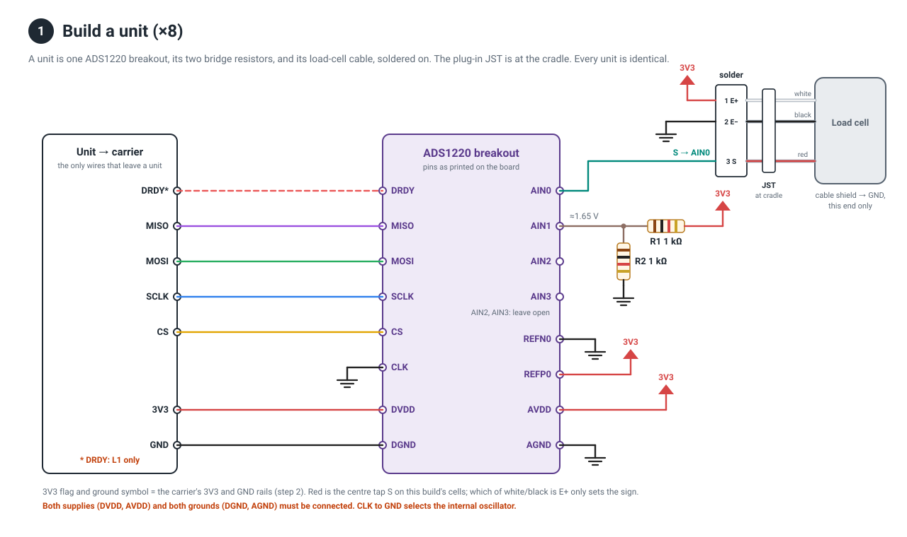
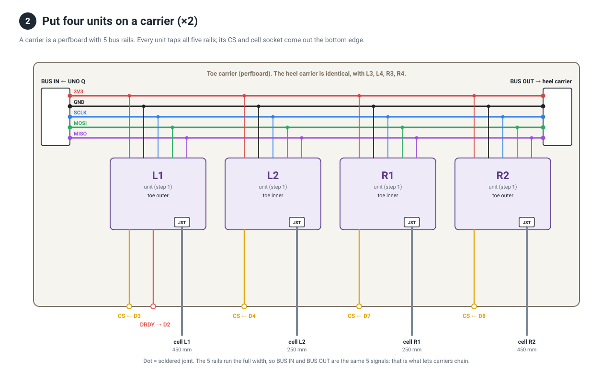
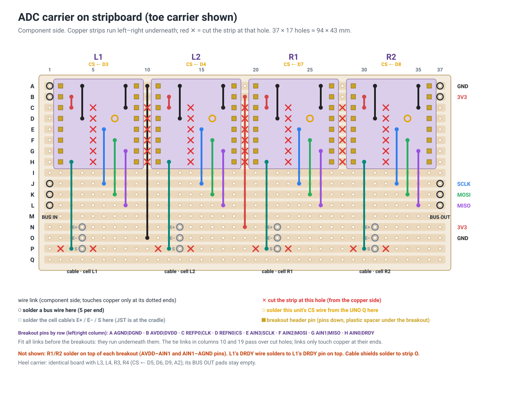
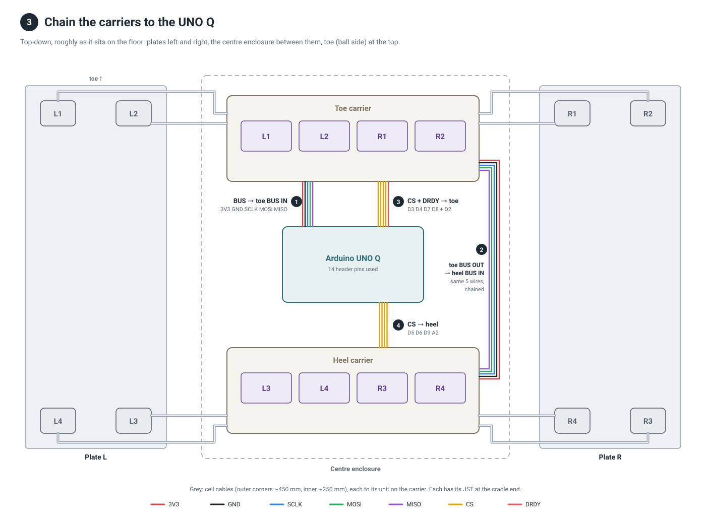

# System wiring, step by step

How 8 load cells, 8 ADS1220 breakouts and the UNO Q connect. The build is in three steps:

1. **Build 8 identical units.** A unit is one breakout, its two bridge resistors, and a socket for its cell.
2. **Mount 4 units on each of two carriers.** A carrier is a perfboard whose 5 bus rails join its units.
3. **Chain the carriers to the UNO Q.** One bus runs from the Q to the toe carrier and on to the heel carrier. Each carrier also gets a bundle of chip-select wires.

Test each unit on the bench before it goes on a carrier: see [`bench-single-cell.md`](bench-single-cell.md). Pin assignments and the reasoning behind them are in [`wiring.md`](wiring.md).

## 1. Build a unit (×8)

A unit is the one-cell bench circuit with the UNO Q replaced by a **6-wire connector**: **3V3, GND, SCLK, MOSI, MISO, CS**. Unit L1 also has **DRDY**. Everything else stays on the unit:

- **Supplies and grounds:** DVDD and AVDD go to 3V3; DGND and AGND go to GND. Both of each pair.
- **Reference:** REFP0 goes to 3V3, REFN0 to GND. The ADC then measures relative to its own supply, so supply drift cancels.
- **CLK** goes to GND, selecting the internal oscillator.
- **R1 and R2 (1 kΩ 0.1 %):** AVDD → R1 → AIN1 → R2 → AGND, soldered at the breakout.
- **JST-XH socket for the cell:** pin 1 E+, pin 2 E−, pin 3 S → AIN0. **Red is S** on this build's cells. White/black are E+/E−; swapping them only flips the sign, which is a config setting.
- **The cell cable's shield** goes to GND at this end only.

Label each unit L1…R4 as you build it. Before it goes on a carrier, run the bench test on it (`tools/bench/single_cell.py`). The bench sketch only reads the unit on CS D3, so wire each unit to D3 for its test.

## 2. Put four units on a carrier (×2)

Each carrier is a strip of 2.54 mm perfboard:

- **5 bus rails** run the full width: 3V3, GND, SCLK, MOSI, MISO. Use 22 AWG for 3V3 and GND.
- **Each unit taps all 5 rails** with short wires (the dots in the drawing).
- **BUS IN / BUS OUT:** a 5-pin header at each end of the rails. BUS IN takes the bus from the Q (toe carrier) or from the other carrier (heel carrier). BUS OUT passes it on. **This is what lets the carriers chain:** the rails are continuous, so BUS OUT carries the same 5 signals as BUS IN.
- **Along the bottom edge:** each unit's **CS** pin (and L1's **DRDY**), and each unit's **JST** for its cell cable.

| Carrier | Units | CS pins on the UNO Q | Extra |
|---|---|---|---|
| Toe (+y end pad) | L1, L2, R1, R2 | D3, D4, D7, D8 | L1's DRDY → D2 |
| Heel (−y end pad) | L3, L4, R3, R4 | D5, D6, D9, **A2** | BUS OUT not used |

### Building a carrier on stripboard

Use single-sided 2.54 mm stripboard, 37 × 17 holes (about 94 × 43 mm). That fits the enclosure between the UNO Q and the lid posts, roughly x = 40–134 mm from centre, overhanging the 90 mm pad a little at each end. Mount it on the pad with **nylon** standoffs through holes in the unused strips I and M. The breakout's pins pair up across the board (AGND|DGND, AVDD|DVDD, …), so with the header columns across the strips:

- **Strip A is the GND rail and strip B the 3V3 rail**, running under all four breakouts and never cut.
- **Strips J, K, L are the SCLK, MOSI and MISO rails.**
- **Strips N and O repeat 3V3 and GND** next to the JSTs, tied to B and A by the links in columns 19 and 10.

Build order:

1. **Cut the strips (✕):**
   - rows C–H at columns 5, 14, 23, 32, which falls between each breakout's two header columns
   - rows C–H at columns 10, 19, 28, between breakouts
   - row P at columns 2, 5, 11, 14, 20, 23, 29, 32, so each unit's S strip is separate

   Cut from the copper side and count columns carefully, because the board is mirrored when flipped. Check every cut with a meter.
2. **Fit the wire links**, all of them before any breakout, since they run underneath. Per breakout, with x0 = its left header column (2, 11, 20, 29):

   | Link | From | To |
   |---|---|---|
   | REFP0 → 3V3 | x0+1, C | x0+1, B |
   | REFN0 → GND | x0+2, D | x0+2, A |
   | CLK → GND | x0+6, C | x0+6, A |
   | SCLK → rail | x0+4, E | x0+4, J |
   | MOSI → rail | x0+5, F | x0+5, K |
   | MISO → rail | x0+6, G | x0+6, L |
   | AIN0 → S | x0+1, H | x0+1, P |

   Plus two tie links: **column 10, A→O** (GND) and **column 19, B→N** (3V3).
3. **Fit the JSTs:** column x0+2, rows N–Q. Pin 1 (E+) goes on N, pin 2 (E−) on O, pin 3 (S) on P, pin 4 on Q (unused).
4. **Solder the breakouts:** pins down, header spacer underneath, left column (AGND…AIN0) at x0 and right column (DGND…DRDY) at x0+7, rows A–H. Then solder **R1 (AVDD–AIN1) and R2 (AIN1–AGND)** on top of each breakout.
5. **External wires:**
   - the bus into column 1 (BUS IN) and column 37 (BUS OUT) on strips A, B, J, K, L
   - each unit's CS into hole (x0+5, D)
   - L1's DRDY onto L1's DRDY pin on top
   - each cell cable's shield onto strip O

The heel carrier is the same board with L3, L4, R3, R4 (CS ← D5, D6, D9, A2); leave its BUS OUT empty.

Don't use a solderless breadboard for the carriers. A swing shakes the floor, and a loose contact on CS or MISO corrupts readings in ways that are hard to track down.

## 3. Chain the carriers to the UNO Q

Four bundles leave the UNO Q's header area, plus the cell cables:

| # | From | To | Wires |
|---|---|---|---|
| ① | UNO Q **3V3, GND, D13, D11, D12** | toe carrier **BUS IN** | 3V3, GND, SCLK, MOSI, MISO |
| ② | toe carrier **BUS OUT** | heel carrier **BUS IN** | the same 5, chained |
| ③ | UNO Q **D3, D4, D7, D8, D2** | toe carrier bottom edge | CS L1, L2, R1, R2 + L1's DRDY |
| ④ | UNO Q **D5, D6, D9, A2** | heel carrier bottom edge | CS L3, L4, R3, R4 |
| — | each cell | its unit's JST | ~450 mm outer corners, ~250 mm inner |

That's **14 UNO Q pins, one wire each**. The 5 bus signals reach all 8 units through the chain, not through 8 wires on each pin.

**Never connect:** D10 (the SPI hardware chip select), D0/D1 (the MCU console), or any DRDY other than L1's. DRDY outputs are push-pull and would fight each other.

## 4. Check before power

With the UNO Q unplugged:

- [ ] **3V3 to GND ≈ 125 Ω.** That's 8 corners of 1 kΩ in parallel. Near 0 Ω is a short.
- [ ] Each CS pin reaches **only** its own unit (D3 → L1 … D9 → R3, A2 → R4).
- [ ] BUS IN and BUS OUT on each carrier show continuity rail by rail, and the heel carrier's rails match the toe carrier's.
- [ ] Only L1's DRDY reaches D2; nothing connects to D10, D0 or D1.
- [ ] Each cable shield connects to GND at the carrier end and to nothing at the cell end.

Then power up and bring units up **one at a time**: plug in one cell's JST, check it, then the next. Each unit's bench-tested numbers (noise, readback) are the reference.
